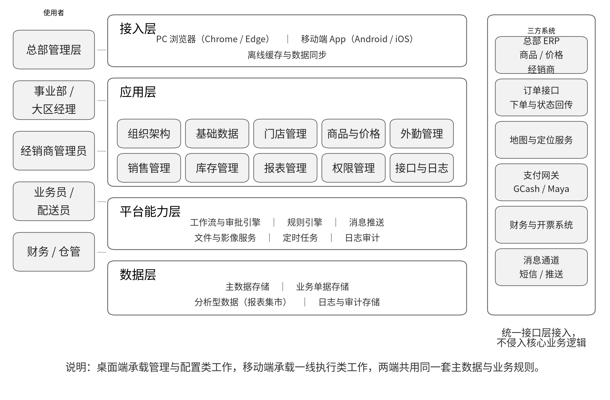
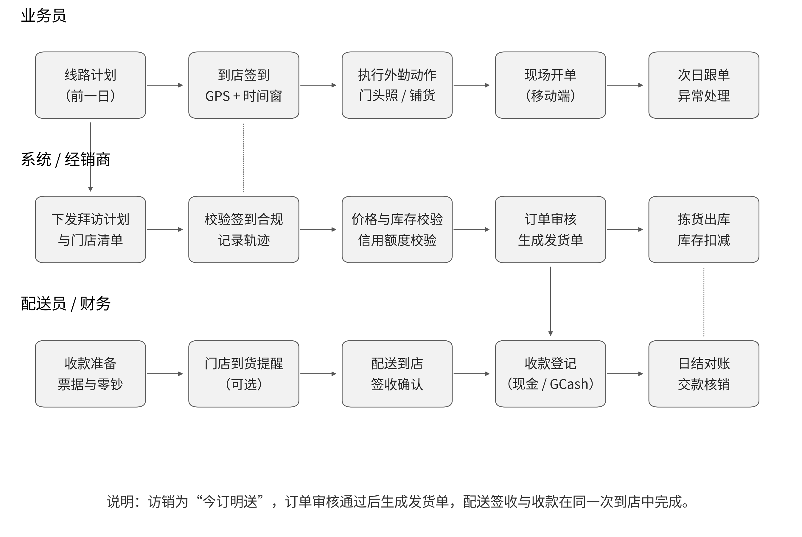
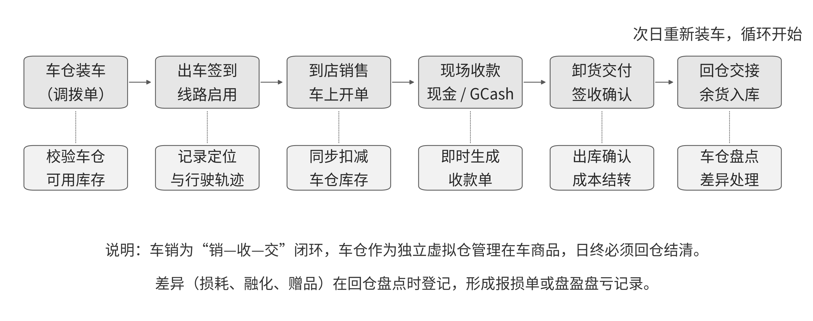
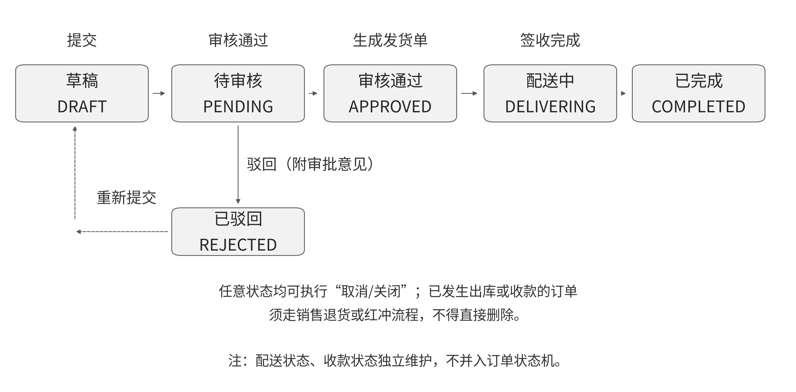

# 2  系统总体要求

> 来源：《蒙牛菲律宾冰淇淋经销商运营系统 PRD V1.0》第 2 章。原文状态为“需求评审稿（待业务方确认）”，本文件按模块整理，未改变业务规则。

[返回文档总目录](../README.md)

## 2.1  建设目标

系统建设的总目标是：以门店为中心，把经销商的“人、店、货、单、款”纳入同一套系统管理，实现外勤过程可验证、订单履约可追踪、库存数量可核对、应收资金可对账，并通过统一口径的报表支撑总部对四个大区的横向比较与纵向督导。

围绕总目标，分解为四项分目标。第一，过程可视化：业务员的每一次到店、每一项动作、每一张照片都形成带时间与位置的记录，督导从“听汇报”转为“看数据”。第二，订单闭环化：订单从生成、审核、发货、签收到收款形成完整链条，各环节责任人与时间戳可追溯。第三，库存准确化：经销商仓与车仓的数量变动全部由单据驱动，账实差异可定位到具体单据与责任人。第四，对账自动化：业务员日经手的订单与收款由系统自动汇总，交款差异在当日闭环。

为便于验收，建设目标需落实为可度量的指标。下表指标为目标值，现状基线须在项目启动后的调研阶段采集并回填，未采集前以“待调研”标注，不得以估算值替代。

**表5  建设目标量化指标**

| 序号 | 指标 | 现状基线 | 目标值 | 度量方式 |
| --- | --- | --- | --- | --- |
| 1 | 门店主数据完整率（必填字段齐备） | 待调研 | ≥ 98% | 系统内必填字段非空且通过地址与坐标校验的门店数 ÷ 门店总数 |
| 2 | 计划拜访签到率 | 待调研 | ≥ 95% | 有效签到次数 ÷ 计划拜访次数，按周统计 |
| 3 | 订单线上化率 | 待调研 | ≥ 90% | 系统内生成的订单金额 ÷ 全部订单金额 |
| 4 | 订单当日审核及时率 | 待调研 | ≥ 95% | 当日 24 点前完成审核的订单数 ÷ 当日提交订单数 |
| 5 | 库存账实差异率 | 待调研 | ≤ 1% | 月度盘点差异金额 ÷ 期初加本期入库金额 |
| 6 | 应收对账完成时效 | 待调研 | T+1 日 12 点前 | 业务员交款单确认时间与业务发生日的时间差 |
| 7 | 报表出数时间（月度销售报表） | 待调研 | ≤ 5 秒 | 从点击查询到首屏结果返回的时间，数据量按一百万行估算 |
| 8 | 移动端离线开单成功率 | 待调研 | ≥ 99% | 离线提交后成功同步的订单数 ÷ 离线提交订单数 |

## 2.2  建设原则

系统需同时满足总部管控与一线易用的双重诉求，二者在实施中经常冲突。以下六条原则用于在需求取舍时给出判断依据：当易用性与管控要求冲突时，优先保证数据真实性；当功能完整性与上线时效冲突时，优先保证核心链路可用。

**表6  建设原则与落地要求**

| 原则 | 内涵 | 落地要求 |
| --- | --- | --- |
| 业务驱动 | 功能设计以真实作业顺序为依据，不为管理便利增加一线无效录入 | 移动端一次拜访的操作步骤不超过 6 步；重复信息由系统带出，业务员只填差异项 |
| 一套主数据 | 组织、门店、商品、价格、客户档案在系统中唯一，各端各模块引用同一份数据 | 禁止在业务模块内单独维护商品或客户副本；变更走统一入口并留痕 |
| 过程留痕 | 关键动作必须由系统生成时间、位置、操作人三类证据 | 签到、拍照、签收、交款均记录 GPS 与设备时间，事后不可修改，只能作废重做 |
| 单据驱动库存 | 库存只随单据变动，任何手工调整必须落到单据上 | 禁止提供“直接改库存数”的功能；差异通过盘盈盘亏单处理 |
| 权限跟随组织 | 数据可见范围由组织归属决定，越级查看需显式授权 | 经销商之间数据默认隔离；跨经销商汇总仅对事业部与大区角色开放 |
| 可离线、可追溯 | 移动端在弱网下可用，数据回传后仍能完整追溯原始提交时间与设备 | 离线数据带本地时间戳与设备标识，上传后保留“离线提交”标记 |

## 2.3  系统边界

明确边界是控制一期范围的前提。下表列出系统承担、不承担以及依赖外部提供的能力，凡属“不承担”的内容，需求评审时不再展开讨论。

**表7  系统边界**

| 类别 | 内容 | 说明 |
| --- | --- | --- |
| 系统承担 | 组织与人员管理、门店与商品主数据、价格政策、外勤过程管理、订单与发货、库存与调拨、收款与对账、报表分析、权限与日志 | 覆盖经销商日常经营的全部作业环节，是本文档详述的对象 |
| 系统承担 | 与总部系统的订单接口、与地图服务的位置解析、与支付渠道的收款结果回传 | 仅承担数据交换与状态同步，不承担对方系统的内部逻辑 |
| 不承担 | 总账核算、法定财务报表、税务申报、资金池管理 | 由集团财务系统与当地财税服务商承担，本系统仅提供应收与收款明细数据 |
| 不承担 | 生产计划、工厂发运、进口清关 | 由供应链系统承担，本系统以入库单承接其到货结果 |
| 不承担 | 人事薪酬、考勤薪资计算 | 由人力资源系统承担，本系统仅使用人员组织信息与出勤结果 |
| 外部依赖 | 门店地址与坐标解析（地图服务）、移动端定位、消息推送、支付渠道对账文件 | 需在实施阶段确认服务可用性与调用配额，菲律宾部分地区定位精度有限，须允许手工校正坐标 |
| 外部依赖 | 总部 ERP 的商品、价格、经销商主数据 | 以接口同步为主，接口不可用时允许模板导入作为兜底 |

## 2.4  总体架构

系统采用分层架构，自下而上分为数据层、平台能力层、应用层与接入层，并通过统一接口层与外部系统交互。分层的目的不是技术堆叠，而是把“主数据与规则”沉到下层复用，把“场景与流程”放在上层编排，避免同一规则在不同模块重复实现导致口径分叉。

图1  系统总体架构

**表8  架构分层职责**

| 层次 | 主要组成 | 职责与约束 |
| --- | --- | --- |
| 接入层 | PC 浏览器端、移动端 App、离线缓存与同步组件 | PC 端面向管理与配置，移动端面向一线执行；两端使用同一套接口与权限模型 |
| 应用层 | 组织架构、基础数据、门店管理、商品与价格、外勤管理、销售管理、库存管理、报表管理、权限管理、接口与日志 | 按业务域划分模块，模块间只通过单据与主数据发生关系，不允许跨模块直连数据库表 |
| 平台能力层 | 工作流与审批引擎、规则引擎、消息推送、文件与影像服务、定时任务、日志审计 | 外勤规则、信用控制、审批路径等可变策略由规则引擎统一承载，避免硬编码 |
| 数据层 | 主数据存储、业务单据存储、分析型数据（报表集市）、日志与审计存储 | 业务库与分析库分离，报表查询不直接压业务库；日志独立存储且不可篡改 |
| 接口层 | 订单接口、主数据接口、地图服务、支付与消息通道 | 统一鉴权、统一幂等、统一报文规范与失败重试策略 |

## 2.5  用户角色与权限概览

系统按角色而非按人授权。角色绑定业务单元后，数据可见范围随组织层级自动收敛，避免为每个经销商单独配置权限。下表为角色清单与职责边界，具体权限项在第3.9节展开。

**表9  角色与职责边界**

| 角色 | 所属层级 | 核心职责 | 主要使用端 | 数据可见范围 |
| --- | --- | --- | --- | --- |
| 总部管理员 | 总部 | 系统配置、组织与主数据维护、全局权限分配、接口监控 | PC | 全部业务单元 |
| 事业部经理 | 事业部 | 品类策略、价格审批、四个大区的目标下达与达成分析 | PC | 本事业部及全部大区、经销商 |
| 大区经理 | 大区 | 辖区内经销商督导、线路与外勤规则审核、业绩与拜访质量检查 | PC + 移动端 | 本大区及辖区经销商 |
| 经销商管理员 | 经销商 | 本经销商的门店、商品价格、人员、仓库与线路配置 | PC | 本经销商 |
| 经销商财务 | 经销商 | 价格与信用维护、订单收款核销、业务员交款确认、对账与报表 | PC | 本经销商（财务相关全量） |
| 业务员 | 经销商 | 按线路拜访门店、执行外勤动作、开单、收款、日终交款 | 移动端 | 本人负责的门店与线路 |
| 配送员 | 经销商 | 按发货单配送、签收确认、代收货款移交 | 移动端 | 本人被派发的发货单 |
| 仓管员 | 经销商 | 入库、出库、调拨、盘点、车仓装卸 | PC + 移动端 | 本经销商全部仓库 |
| 数据分析员 | 总部 / 事业部 | 报表查询与导出，不参与业务操作 | PC | 被授权的汇总数据，只读 |

## 2.6  核心业务流程

本节描述跨模块的主干流程。各模块内部的字段与按钮规则在第3章展开，此处只说明角色分工、单据产生顺序与关键控制点。

### 2.6.1  组织与主数据建立流程

实施阶段按“先组织、后基础数据、再商品与价格、最后门店与线路”的顺序建档。总部管理员先建立总部、事业部与大区三级业务单元，再将四十余家经销商逐一挂接到所属大区；经销商管理员在获得账号后，补齐本单位的部门与人员，维护仓库与车辆，导入商品与价目表，最后按线路批量导入门店。

主数据变更遵循“谁维护、谁负责”的原则。组织与人员由总部或经销商管理员维护，商品与品牌由事业部维护，价格由事业部制定、经销商在授权范围内维护终端执行价，门店档案由业务员在移动端采集、经销商管理员审核后生效。跨层级的数据变更需通知上级，系统在变更日志中记录操作人与生效时间。

### 2.6.2  访销业务流程

访销是本期最核心的作业链路，其特点是“今日订、明日送”，订单与配送在时间上分离，因此必须保证订单审核、库存占用与配送排程三者衔接一致。完整流程见图2。

图2  访销业务流程

流程节点与责任分工如下表。表中“系统动作”指系统自动完成或强制的处理，“人工动作”指必须由角色在界面上确认的操作，二者不得混淆，以免开发阶段遗漏自动校验。

**表10  访销流程节点与责任分工**

| 步骤 | 角色 | 人工动作 | 系统动作 | 输出单据 | 关键控制点 |
| --- | --- | --- | --- | --- | --- |
| 1 | 系统 / 经销商管理员 | 维护线路与拜访周期，确认次日计划 | 按线路周期生成次日拜访计划，推送到业务员移动端 | 拜访计划 | 计划生成时点固定为每日 20:00，逾期调整需管理员操作 |
| 2 | 业务员 | 到店后点击“签到” | 采集 GPS、比对门店坐标、校验时间窗与签到距离 | 拜访记录 | 距离超出规则半径时禁止签到，可选择“异常签到”并填写原因 |
| 3 | 业务员 | 按外勤类型执行拍照、铺货上报等动作 | 校验必做动作完成度，未完成不允许提交订单 | 拜访记录、陈列照片 | 照片需带水印（时间、坐标、门店名），禁止从相册上传 |
| 4 | 业务员 | 选择商品与数量，确认价格与赠品 | 取价目表价格、校验库存可用量与信用额度 | 销售订单（待审核） | 超出信用额度时按规则拦截或转大区经理审批 |
| 5 | 经销商管理员 / 财务 | 审核订单，处理驳回 | 生成发货单，占用库存 | 发货单（待配送） | 审核通过后订单锁定，不允许业务员自行修改 |
| 6 | 仓管员 | 拣货并确认出库 | 按发货单扣减库存、结转成本 | 销售出库单 | 出库数量不得大于发货单数量，差异须登记原因 |
| 7 | 配送员 | 送达后请门店签收、登记收款 | 更新配送状态与收款状态，生成应收 | 签收记录、收款单 | 签收需门店签字或拍照，代收现金须录入金额与方式 |
| 8 | 业务员 / 财务 | 日终交款，确认对账结果 | 汇总当日订单与收款，生成对账单与交款单 | 业务员对账单、交款单 | 差异未处理前不允许关闭当日对账 |

### 2.6.3  车销业务流程

车销把“仓”搬到了车上：业务员既是销售也是送货人，成交、交付、收款在同一时点完成。这一模式对库存准确性要求更高，因为车仓数量一旦失真，现场就会出现“有单无货”或“有货无单”。完整流程见图3。

图3  车销业务流程

车销的关键控制点有四个：装车时必须校验车仓可用量并生成调拨单；现场开单必须实时扣减车仓库存，离线状态下按本地可用量控制并在同步时校验冲突；收款必须即时生成收款单并与订单关联；日终回仓必须完成余货入库与车仓盘点，差异当日登记，不得跨日挂账。

**表11  车销流程节点与责任分工**

| 步骤 | 角色 | 人工动作 | 系统动作 | 输出单据 | 关键控制点 |
| --- | --- | --- | --- | --- | --- |
| 1 | 仓管员 / 业务员 | 按计划拣货装车 | 校验经销商仓可用量，生成调拨单并扣减源仓 | 调拨单（经销商仓→车仓） | 装车数量不得超过车辆核定载量，超载需提示 |
| 2 | 业务员 | 出车签到 | 记录出车时间与位置，启用当日车销线路 | 外勤记录 | 未签到不允许开单，防止事后补录 |
| 3 | 业务员 | 到店后开单、确认卸货 | 按车仓可用量校验，实时扣减车仓库存 | 销售订单（即时完成） | 车销订单默认为“已审核”，无需二次审批，但受最低售价控制 |
| 4 | 业务员 | 收取现金或扫码收款 | 生成收款单，登记结算方式与金额 | 收款单 | 现金收款须录入实收金额，系统自动计算找零 |
| 5 | 业务员 | 回仓交余货 | 生成调拨单（车仓→经销商仓），恢复可用库存 | 调拨单、退货入库单 | 余货必须全部回仓，不允许留存在车过夜 |
| 6 | 业务员 / 财务 | 日终交款与对账 | 汇总当日车销订单与收款，计算应交与实交差异 | 交款单、业务员对账单 | 差异超过阈值须大区经理确认后方可关闭 |
| 7 | 仓管员 | 车仓盘点 | 比对账面与实盘，生成盘盈盘亏单 | 盘点单 | 损耗、融化、赠品须分类登记，不得合并为一条差异 |

### 2.6.4  收款、交款与对账流程

收款环节存在三种时点：访销的配送签收时收款、车销的现场收款、赊销门店在账期内付款。三种时点在系统中统一表现为“收款单”，区别在于关联对象与核销方式：前两者直接核销对应订单，后者按门店应收余额进行核销，可指定核销订单顺序。

业务员每日结束作业后进入对账：系统按业务员维度汇总当日应发生的订单金额、已登记的收款金额、已移交财务的金额，形成业务员对账单。财务确认交款后，交款单与收款单建立核销关系，对账状态转为“已确认”。存在差异时，对账单进入“差异待处理”，必须逐笔说明原因（如找零未登记、门店拒收、代付、票据未到账），差异原因分类在系统中固定枚举，不允许自由文本作为唯一依据。

### 2.6.5  库存流转

库存按“仓库—批次—商品”三个维度管理，所有变动必须由单据触发。入库来源包括采购到货、调拨入库、销售退货入库、盘盈；出库来源包括销售出库、调拨出库、报损出库、盘亏。车仓作为虚拟仓库参与同一套库存模型，其与经销商仓之间的往来以调拨单体现。

库存数量分为可用量、锁定量与在途量三个口径。可用量等于账面数量减锁定量；订单审核通过即锁定库存，出库后转为实际扣减；调拨在途期间源仓已扣减、目标仓未入账，需在库存查询中单独展示，避免重复计算。冰淇淋按批次与效期管理，出库默认先进先出，效期不足保质期三分之一的批次在拣货环节提示，临期品可配置禁售。

## 2.7  PC 端与移动端的分工

两端不是简单的功能复制，而是按作业场景切分：结构化配置、批量处理、跨对象比对放在 PC 端；需要现场取证、需要即时反馈、需要在无网络环境下完成的操作放在移动端。同一业务对象在两端的能力边界必须清晰，避免出现“移动端能改主数据、PC 端能跳过签到”的口子。

**表12  PC 端与移动端能力分工**

| 业务对象 | PC 端能力 | 移动端能力 | 约束说明 |
| --- | --- | --- | --- |
| 组织与人员 | 新增、编辑、启停用、层级调整、批量导入 | 仅查看本人信息与所属组织 | 移动端不得修改组织层级，防止权限范围被绕过 |
| 门店档案 | 查询、审核、批量导入、分类与线路归属调整 | 查看、新增（待审核）、修改基础信息、采集坐标与照片 | 移动端新增门店须经管理员审核后生效 |
| 商品与价格 | 维护商品、价目表、价格审批 | 查询商品、价格与库存可用量 | 移动端不得改价，仅可按规则申请特价 |
| 订单 | 查询、审核、驳回、作废、改单（审核前） | 开单、提交、查看状态、打印小票（可选） | 审核后的修改只能在 PC 端由管理员操作并留痕 |
| 发货与配送 | 生成发货单、派车、出库确认 | 接单、送达签收、异常上报 | 签收结果只能由配送员在移动端提交 |
| 收款与对账 | 收款核销、交款确认、账龄分析 | 登记收款、查看当日应交、提交交款 | 财务确认动作仅在 PC 端执行 |
| 报表 | 全部报表查询、导出、订阅 | 首页关键指标卡片、个人业绩与拜访统计 | 移动端不提供跨经销商汇总数据 |

## 2.8  全局业务规则

以下规则跨越多个模块，必须在系统层面统一实现。若各模块各自实现，极易出现同一张单据在不同页面显示不同金额或状态的情况。规则编号在后续章节与测试用例中直接引用。

**表13  全局业务规则**

| 编号 | 规则域 | 规则内容 |
| --- | --- | --- |
| GR-01 | 组织层级 | 业务单元最多四级（总部—事业部—大区—经销商），经销商为叶子节点，不得再建下级业务单元。层级调整仅允许同级移动或整体挂接，不允许跨级跳跃 |
| GR-02 | 编码唯一 | 业务单元、部门、人员、门店、商品、仓库、线路的编码在全系统唯一，一经生成不可修改；编码规则见附录A |
| GR-03 | 金额精度 | 金额保留两位小数，四舍五入；单价最多四位小数；数量保留两位小数；单位换算率为整数 |
| GR-04 | 币种 | 本位币为菲律宾比索（PHP），界面统一显示“₱”并带千分位；涉及多币种时按维护的汇率折算，折算差额单独记录 |
| GR-05 | 税务口径 | 商品档案标记含税或不含税，价目表价格默认含税；订单金额、税额、不含税金额三者必须满足勾稽关系，误差不超过 0.01 |
| GR-06 | 时间基准 | 所有业务时间以服务器时间为准，时区为 Asia/Manila；移动端离线数据保留设备时间并单独记录，用于识别补录行为 |
| GR-07 | 状态单向 | 单据状态按定义顺序单向流转，不允许跳级；回退仅允许“审核驳回”与“作废重开”两种路径，且必须留痕 |
| GR-08 | 审批可配 | 审批节点、审批人、金额阈值按业务单元配置，经销商可在总部允许的范围内自定义；审批过程记录每一节点的意见与时间 |
| GR-09 | 软删除 | 主数据停用而非删除，业务单据作废而非删除；已产生下游单据的主数据不允许停用，须先处理关联业务 |
| GR-10 | 幂等控制 | 同一业务请求携带唯一幂等键（业务类型+业务单元+客户端流水号），重复提交返回首次结果，不生成重复单据 |
| GR-11 | 附件规范 | 照片与附件按“业务类型/业务单元/日期”目录存储，保留原始文件与压缩预览；单文件不超过 10MB，单次上传不超过 9 张 |
| GR-12 | 操作留痕 | 所有新增、修改、作废、审核、导出操作写入操作日志，记录操作人、终端、IP、对象标识、变更前后值与结果 |
| GR-13 | 数据权限 | 默认按“本人—本部门—本经销商—本大区—全事业部”五级收敛；跨级查看须在角色中显式授权并记录 |
| GR-14 | 多语言 | 界面支持简体中文与英文，字段值（如商品名、门店名）按录入语言存储，不自动翻译；报表导出使用当前界面语言 |

## 2.9  单据状态体系

### 2.9.1  状态设计原则

PRD 中最易产生歧义的是“状态”二字。同一个订单可能同时处于“已审核”“配送中”“未收款”三种描述，若不加区分，开发会实现成一个字段，导致后期无法表达“部分签收且部分收款”的情况。因此本系统将状态拆为四个相互独立的维度：单据状态（业务处理进度）、配送状态（物流执行进度）、收款状态（资金回收进度）、审批状态（内部决策进度）。

四个维度各自维护、互不覆盖。列表页默认展示单据状态，配送与收款状态以标签形式并列展示；筛选条件允许按任一维度组合过滤。任何维度变更都写入状态变更日志，记录变更前后值、操作人、时间与原因。

### 2.9.2  订单状态

订单状态反映从录入到履约完成的进度。车销订单因现场成交，创建即为“审核通过”，但仍需经过配送与收款两个维度。状态流转见图4。

图4  销售订单状态流转

**表14  销售订单状态定义**

| 状态 | 代码 | 含义 | 可执行操作 | 进入条件 |
| --- | --- | --- | --- | --- |
| 草稿 | DRAFT | 已录入但未提交，可自由修改 | 编辑、删除、提交 | 移动端暂存或离线保存 |
| 待审核 | PENDING | 已提交，等待审核人处理 | 审核通过、驳回、撤回 | 业务员提交，或离线数据同步成功 |
| 审核通过 | APPROVED | 审核完成，允许生成发货单 | 生成发货单、取消 | 审核人确认，库存与信用校验通过 |
| 配送中 | DELIVERING | 已生成发货单并已出库或已在途 | 查看物流、异常上报 | 发货单状态变为配送中 |
| 已完成 | COMPLETED | 全部明细签收完成 | 查看、退货（另开单据） | 发货单全部签收，或车销现场交付完成 |
| 已驳回 | REJECTED | 审核未通过，退回业务员 | 修改后重新提交、作废 | 审核人驳回并填写意见 |
| 已取消 | CANCELLED | 业务终止，不再履约 | 查看 | 审核前由业务员撤回，审核后由管理员取消 |

### 2.9.3  发货与配送状态

发货单是配送执行的载体，其状态必须能表达“部分送达”“拒收”“改约”等真实场景。系统将发货单状态与配送结果分开记录：发货单状态描述执行进度，配送结果描述本次到店的最终结论。

**表15  发货单与配送状态定义**

| 状态 | 代码 | 含义 | 可执行操作 | 说明 |
| --- | --- | --- | --- | --- |
| 待配送 | PENDING | 已生成未派车 | 派车、修改配送日期、取消 | 超过约定配送日期未派车，系统标记“配送延迟” |
| 已派车 | ASSIGNED | 已指定配送员与车辆 | 改派、开始配送 | 同一车辆同一时段不得重复派单 |
| 配送中 | IN\_TRANSIT | 车辆已出库在途 | 到达签收、异常上报 | 开始配送时记录出车时间与位置 |
| 已送达 | DELIVERED | 全部明细签收完成 | 查看签收凭证 | 签收即触发应收生成 |
| 部分送达 | PARTIAL | 部分明细签收，其余拒收或改约 | 生成剩余发货单、登记拒收原因 | 拒收明细需选择原因，进入退货或补发流程 |
| 配送失败 | FAILED | 门店关闭、无人接收、地址错误等 | 重排配送、取消 | 失败原因必填，连续两次失败触发管理员跟进 |
| 已取消 | CANCELLED | 配送指令作废 | 查看 | 已出库的发货单不得取消，须走退货入库 |

**表16  配送结果枚举**

| 配送结果 | 代码 | 适用场景 | 后续处理 |
| --- | --- | --- | --- |
| 正常签收 | SIGNED | 数量与单据一致，门店确认 | 生成应收，进入收款流程 |
| 部分签收 | PARTIAL\_SIGNED | 缺货、临期拒收、门店只要部分品项 | 未签收部分生成剩余单或作废，差异登记原因 |
| 整单拒收 | REJECTED | 价格争议、门店停业、质量问题 | 整单退回，库存回补，订单转“已完成（拒收）”并留痕 |
| 改约 | RESCHEDULED | 门店当日不便收货 | 生成新配送日期，原单关闭并关联新单 |
| 无人接收 | NO\_RECEIVER | 门店关闭或联系人不在 | 记录现场照片与坐标，允许当日二次配送 |

### 2.9.4  收款与应收状态

收款状态按“订单/应收单据”维度计算，不由人工勾选。计算规则为：已核销金额等于零为未收款；大于零且小于应收金额为部分收款；等于应收金额为已收款；超过账期未结清为超期。系统每日定时重算，也允许在收款、退货、红冲发生时实时重算。

**表17  收款与应收状态定义**

| 状态 | 代码 | 判定规则 | 界面表现 | 可执行操作 |
| --- | --- | --- | --- | --- |
| 未收款 | UNPAID | 已核销金额 = 0，且未超过账期 | 灰色标签 | 登记收款、查看应收明细 |
| 部分收款 | PARTIAL\_PAID | 0 &lt; 已核销金额 &lt; 应收金额 | 蓝色标签并显示比例 | 继续收款、核销指定订单 |
| 已收款 | PAID | 已核销金额 = 应收金额（允许 0.01 以内舍入差） | 绿色标签 | 查看收款记录、申请退款 |
| 超期未收 | OVERDUE | 当前日期超过账期截止日且未结清 | 红色标签并显示逾期天数 | 催收、申请展期、转坏账审批 |
| 已核销待确认 | PENDING\_CONFIRM | 业务员已登记，财务尚未确认 | 黄色标签 | 财务确认或驳回 |
| 坏账 | BAD\_DEBT | 经审批确认无法收回 | 深灰标签 | 仅查看；恢复须经事业部审批 |

### 2.9.5  库存单据与对账状态

库存类单据（入库单、出库单、调拨单、盘点单）采用统一的状态模型，保证库存在任何时刻都可解释。对账单与交款单另设状态，用于表达资金移交进度。

**表18  库存单据与对账状态定义**

| 单据类型 | 状态序列 | 说明 |
| --- | --- | --- |
| 入库单 | 草稿 → 待审核 → 已审核 → 已入库 → 已作废 | 已入库才增加库存；采购到货可配置为免审直接入库 |
| 出库单 | 草稿 → 待审核 → 已审核 → 已出库 → 已作废 | 已出库才扣减库存；销售出库由发货单驱动，不允许手工新建 |
| 调拨单 | 草稿 → 待审核 → 已审核 → 在途 → 已入库 → 已作废 | 在途期间源仓已扣、目标仓未增，库存查询需体现“在途量” |
| 盘点单 | 草稿 → 盘点中 → 待审核 → 已审核 → 已调整 | 按仓库与品类生成盘点任务，差异生成盘盈盘亏单后调整库存 |
| 业务员对账单 | 未开始 → 对账中 → 差异待处理 → 待确认 → 已确认 | 每日按业务员生成，已确认后当日数据锁定 |
| 交款单 | 草稿 → 待确认 → 已确认 → 部分核销 → 已核销 | 财务确认实收金额后，与收款单逐笔核销 |

### 2.9.6  状态展示与操作约束

状态不仅是标签，还决定了按钮的可用性。系统要求所有列表与详情页按“当前状态 + 角色权限 + 前置条件”三元组计算按钮状态：不满足条件时按钮置灰并给出悬浮提示说明原因，不允许出现点击后报错的交互。

状态变更必须原子化。以订单审核为例，审核动作需同时完成状态更新、库存锁定、审批记录写入与消息推送，任一步失败则整体回滚。禁止出现“状态已变为审核通过但库存未锁定”的中间态，否则将直接导致超卖。
