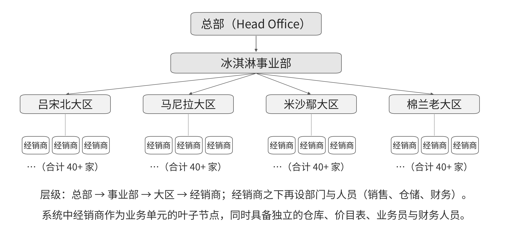

# 3.1  组织架构

> 来源：《蒙牛菲律宾冰淇淋经销商运营系统 PRD V1.0》第 3.1 节。原文状态为“需求评审稿（待业务方确认）”，本文件按模块整理，未改变业务规则。

[返回文档总目录](../../README.md)

> **2026-11-09 开发补充：** 已新增业务单元、部门、人员演示及按登录成员控制的租户/组织范围。具体实现、问题修复、演示账号、验收步骤与未完成项见[演示实现与验收](演示实现与验收.md)。下文保留原 PRD 摘录，不能单独作为已实现清单。

## 3.1.1  模块概述

组织架构模块是整个系统权限与数据范围的根。业务单元决定“谁属于哪个组织”，部门决定“在组织内归属哪个职能”，人员决定“谁可以登录、能看哪些数据”。三者自上而下串联，任何一处配置错误都会导致数据权限错乱，因此本模块的增删改查必须具备比普通主数据更严格的校验。

组织架构的层级为总部—事业部—大区—经销商四级，经销商是叶子节点。系统在经销商之下不再设业务单元，但允许经销商建立自己的部门（销售部、仓储部、财务部等）与人员。经销商的门店、仓库、车辆均挂在该经销商业务单元下，形成完整的管理闭环。

图5  组织层级示意

## 3.1.2  菜单与页面结构

**表20  组织架构页面结构**

| 二级菜单 | 页面形态 | 核心内容 | 默认排序 |
| --- | --- | --- | --- |
| 业务单元 | 树形表格（可展开/收起）+ 顶部筛选 + 编辑抽屉 | 按层级缩进展示编码、名称、类型、上级、负责人、状态 | 按层级与排序号升序 |
| 部门 | 平铺列表 + 层级路径列 | 一次性展示全部部门，通过“层级路径”列体现上下级关系 | 按业务单元、层级、排序号 |
| 人员 | 左侧部门组织树 + 右侧人员列表 | 左侧树用于筛选部门，右侧列表展示该部门及下级部门人员 | 按工号升序 |

## 3.1.3  业务单元

业务单元页面采用树形表格：默认展开到第二级，每行左侧按层级缩进并显示展开箭头，点击箭头展开其下级，再次点击收起。上级行始终显示下级数量（如“下级 4”），便于在不展开的情况下判断组织规模。筛选条件支持按名称、编码、类型、状态组合查询，查询结果保留层级关系，不将树拍平。

**表21  业务单元功能点**

| 功能编号 | 功能点 | 功能描述 | 优先级 |
| --- | --- | --- | --- |
| FR-ORG-01 | 新增顶级业务单元 | 在列表顶部“新增”按钮创建，仅总部管理员可用；系统中已存在总部时该按钮置灰并提示 | P0 |
| FR-ORG-02 | 新增下级业务单元 | 在行操作中点击“新增下级”，自动带入上级编码与层级，层级超出四级时禁止创建 | P0 |
| FR-ORG-03 | 编辑业务单元 | 修改名称、负责人、联系方式、地址、启用状态等；编码与类型不可修改 | P0 |
| FR-ORG-04 | 启用 / 停用 | 停用后该单元及其下级不可被新单据引用，已有单据保留；同时校验在职人员与未完结单据 | P0 |
| FR-ORG-05 | 删除业务单元 | 仅允许删除从未产生任何业务数据、且无下级、无人员的业务单元；其余情况只能停用 | P0 |
| FR-ORG-06 | 展开 / 收起 / 全部展开 | 支持逐行展开与一键全部展开，展开状态在当前会话内记忆 | P1 |
| FR-ORG-07 | 层级调整 | 将某个业务单元整体挂接到另一上级，系统校验层级深度与类型合法性，调整后刷新全部人员数据权限 | P1 |
| FR-ORG-08 | 导入 / 导出 | 支持按模板批量导入；导出字段与列表一致，导出记录写操作日志 | P1 |
| FR-ORG-09 | 查看下级统计 | 行内展示下级数量、人员数量、门店数量、经销商数量（按类型展示） | P2 |

**表22  业务单元字段说明**

| 字段 | 类型 | 必填 | 长度/范围 | 说明与校验 |
| --- | --- | --- | --- | --- |
| 业务单元编码 | 文本 | 是 | ≤ 20 字符 | 全局唯一，按附录A规则生成；创建后不可修改 |
| 业务单元名称 | 文本 | 是 | ≤ 60 字符 | 同一上级下不可重名；支持中英文双语字段分别录入 |
| 业务单元类型 | 枚举 | 是 | 总部/事业部/大区/经销商 | 决定该单元可挂接的下级类型与可用功能；类型不可修改 |
| 上级业务单元 | 树选择 | 否 | — | 顶级单元为空；经销商必须有大区作为上级，大区必须有事业部作为上级 |
| 层级 | 整数 | 自动 | 1—4 | 由上级层级自动加一，不允许手工输入 |
| 负责人 | 人员选择 | 是 | — | 从本级或下级人员中选择；负责人离职时提示更换 |
| 联系电话 | 文本 | 是 | ≤ 20 字符 | 允许“+63”国际区号格式，校验数字与连接符 |
| 所在地址 | 文本 | 是 | ≤ 200 字符 | 按省/市/区/街道分段录入，用于地图定位与报表归属 |
| 默认币种 | 枚举 | 是 | PHP/USD/CNY | 经销商默认 PHP；报表折算按此币种展示 |
| 默认语言 | 枚举 | 是 | 中文/英文 | 影响该单元下人员的默认界面语言 |
| 纳税人识别号 | 文本 | 条件 | ≤ 30 字符 | 类型为经销商时必填，用于开具收据；格式按当地税务要求校验 |
| 默认账期 | 整数 | 条件 | 0—90 天 | 类型为经销商时必填，新建客户时作为默认值 |
| 生效日期 | 日期 | 是 | — | 决定该单元从何时起参与业务，早于当前日期的补录需说明原因 |
| 排序号 | 整数 | 否 | 1—9999 | 同级排序，数值小者靠前 |
| 状态 | 枚举 | 是 | 启用/停用 | 停用需填写原因；停用不删除历史数据 |
| 备注 | 文本 | 否 | ≤ 500 字符 | 记录特殊约定，不参与业务计算 |

**表23  业务单元按钮与交互**

| 按钮 | 位置 | 前置条件 | 执行结果 | 异常与提示 |
| --- | --- | --- | --- | --- |
| 新增 | 列表顶部左侧 | 当前用户具备新增权限 | 打开新增抽屉，默认上级为空 | 无上级且系统已有总部时，提示“总部已存在，请使用新增下级” |
| 新增下级 | 行操作列 | 该行类型不是经销商 | 打开新增抽屉，自动带入上级与层级 | 层级已达四级时按钮置灰，提示“经销商为最末级” |
| 编辑 | 行操作列 | 具备编辑权限且单元未停用 | 打开编辑抽屉，编码与类型只读 | 停用状态下仅可修改联系方式与备注 |
| 启用 / 停用 | 行操作列 | 启用需上级为启用状态 | 切换状态并刷新下级可见性 | 存在在职人员或未完结订单时，提示具体数量并阻止停用 |
| 删除 | 行操作列 | 无下级、无人员、无业务数据 | 二次确认后物理删除 | 存在引用时提示“请使用停用”，不提供强制删除 |
| 全部展开 | 列表工具栏右侧 | — | 展开全部层级 | 数据超过 500 行时先提示性能风险，再执行 |

说明：删除按钮与停用按钮必须在视觉上区分，删除为不可逆操作，需二次确认并输入删除原因；停用为一键切换，可随时恢复。

## 3.1.4  部门

部门页面不做树形折叠，而是以平铺列表一次性展示全部部门，通过“层级路径”列直观呈现上下级关系（如“冰淇淋事业部 / 销售部 / 马尼拉一组”）。这样处理的原因是多级折叠在部门数量较多时反而降低查找效率，平铺配合路径列更适合按名称搜索。列表支持按业务单元、状态、部门名称筛选，路径列可点击任一层级快速过滤。

**表24  部门功能点**

| 功能编号 | 功能点 | 功能描述 | 优先级 |
| --- | --- | --- | --- |
| FR-DEPT-01 | 新增部门 | 选择所属业务单元与上级部门，自动生成层级路径 | P0 |
| FR-DEPT-02 | 编辑部门 | 修改名称、负责人、编制、排序；层级调整需先解除下级 | P0 |
| FR-DEPT-03 | 启用 / 停用部门 | 停用后该部门人员不可被新单据引用，需提示在职人数 | P0 |
| FR-DEPT-04 | 删除部门 | 仅允许删除无人员、无下级的部门 | P0 |
| FR-DEPT-05 | 按层级路径筛选 | 点击路径中的任一层级，列表收敛为该层级及其下级 | P1 |
| FR-DEPT-06 | 批量导入部门 | 按模板导入，校验同一业务单元内编码唯一 | P1 |
| FR-DEPT-07 | 部门人员数统计 | 列表展示在职人数、业务员人数，点击可跳转人员列表 | P2 |

**表25  部门字段说明**

| 字段 | 类型 | 必填 | 说明与校验 |
| --- | --- | --- | --- |
| 部门编码 | 文本 | 是 | 同一业务单元内唯一，≤ 20 字符 |
| 部门名称 | 文本 | 是 | 同一上级下不可重名，≤ 40 字符 |
| 所属业务单元 | 下拉 | 是 | 默认取当前用户所属单元；不可选择已停用单元 |
| 上级部门 | 下拉 | 否 | 为空表示该单元下的一级部门；部门层级最多 5 级 |
| 层级路径 | 文本 | 自动 | 由系统按“业务单元/部门/子部门”拼接生成，只读 |
| 部门负责人 | 人员选择 | 否 | 必须属于本部门或下级部门 |
| 编制人数 | 整数 | 否 | 用于对比实际在职人数，超编时在人员列表提示 |
| 状态 | 枚举 | 是 | 启用/停用，停用需填写原因 |
| 备注 | 文本 | 否 | ≤ 200 字符 |

**表26  部门按钮与交互**

| 按钮 | 位置 | 执行结果 | 异常与提示 |
| --- | --- | --- | --- |
| 新增 | 列表顶部 | 选择业务单元后打开新增表单 | 无可用业务单元时提示先创建业务单元 |
| 编辑 | 行操作列 | 打开编辑表单，层级路径只读 | 修改上级部门需另走“调整层级”操作 |
| 停用 | 行操作列 | 切换状态 | 存在在职人员时提示人数并阻止停用 |
| 删除 | 行操作列 | 二次确认后删除 | 存在人员或下级时按钮置灰 |

## 3.1.5  人员

人员页面左侧为部门组织树，自上而下展示业务单元—部门—子部门，树节点后显示该部门在职人数；右侧为对应部门（含下级部门）的人员列表。点击左侧任一节点，右侧即时刷新，默认展示该节点下全部人员而非仅直属人员，避免管理者反复点击。

人员与角色、线路、车辆强关联：业务员必须绑定至少一条线路，否则系统无法为其生成拜访计划，移动端登录后会提示“未配置线路”；配送员必须绑定车辆或默认配送区域；财务人员需绑定可操作的经销商业务单元。上述关联在新增人员时以“岗位类型”驱动，岗位类型决定后续必填项。

**表27  人员功能点**

| 功能编号 | 功能点 | 功能描述 | 优先级 |
| --- | --- | --- | --- |
| FR-EMP-01 | 新增人员 | 录入基础信息、组织归属、岗位类型与角色，系统生成唯一工号 | P0 |
| FR-EMP-02 | 编辑 / 调岗 | 修改部门、岗位、直接上级；调岗后数据权限即时刷新，原负责门店需重新分配或转交 | P0 |
| FR-EMP-03 | 启停用人员 | 停用后禁止登录，回收数据权限；存在未完成拜访或未交款时提示清单 | P0 |
| FR-EMP-04 | 重置密码 | 生成临时密码并记录操作，首次登录强制修改 | P0 |
| FR-EMP-05 | 分配角色 | 一人可多角色，角色按业务单元校验可用范围 | P0 |
| FR-EMP-06 | 绑定线路与车辆 | 业务员绑定线路；车销业务员绑定车辆与车仓 | P0 |
| FR-EMP-07 | 离职转交 | 批量将该人员名下门店、未完结订单、应收转交给指定接收人 | P1 |
| FR-EMP-08 | 人员导入 / 导出 | 支持模板批量导入与全量导出 | P1 |
| FR-EMP-09 | 组织树与人数统计 | 左侧树展示各节点在职人数，支持关键字定位部门 | P1 |

**表28  人员字段说明**

| 字段 | 类型 | 必填 | 说明与校验 |
| --- | --- | --- | --- |
| 工号 | 文本 | 是 | 全局唯一，规则见附录A；创建后不可修改 |
| 姓名 | 文本 | 是 | ≤ 40 字符；支持本地拼写 |
| 英文名 / 别名 | 文本 | 否 | ≤ 40 字符，用于英文界面与配送单据打印 |
| 所属业务单元 | 下拉 | 是 | 由部门自动带出，不可跨单元选择部门 |
| 所属部门 | 树选择 | 是 | 必须为启用状态的叶子或非叶子部门 |
| 岗位类型 | 枚举 | 是 | 业务员/配送员/仓管/财务/管理员/其他；决定后续必填项与可用功能 |
| 角色 | 多选 | 是 | 至少一个；角色可用范围须与所属业务单元匹配 |
| 直接上级 | 人员选择 | 否 | 不能选择本人或其下级，避免形成环 |
| 手机号 | 文本 | 是 | 作为登录账号，全局唯一；格式 +63XXXXXXXXXX 或 09XXXXXXXXX |
| 邮箱 | 文本 | 否 | 格式校验；用于接收系统通知 |
| 入职日期 | 日期 | 是 | 不得晚于当前日期 90 天以上，超出需说明 |
| 离职日期 | 日期 | 条件 | 停用状态下必填，且不早于入职日期 |
| 默认线路 | 下拉 | 条件 | 岗位类型为业务员时必填；支持多选，主线路唯一 |
| 绑定车辆 | 下拉 | 条件 | 岗位类型为车销业务员或配送员时必填 |
| 账号状态 | 枚举 | 是 | 启用/停用/锁定；连续 5 次密码错误自动锁定 |
| 头像 | 图片 | 否 | ≤ 2MB，用于移动端展示与签收凭证 |

**表29  人员按钮与交互**

| 按钮 | 位置 | 执行结果 | 异常与提示 |
| --- | --- | --- | --- |
| 新增 | 列表顶部 | 打开新增表单，工号自动生成可覆盖 | 所属单元下无可用部门时提示先建部门 |
| 编辑 | 行操作列 | 打开编辑表单 | 停用人员仅可修改联系方式 |
| 停用 / 启用 | 行操作列 | 切换账号状态 | 存在未交款或未完成拜访时，列出清单并要求先处理或转交 |
| 重置密码 | 行操作列 | 弹出确认并生成临时密码 | 操作写入日志，密码不在日志中明文记录 |
| 分配角色 | 行操作列 | 打开角色选择弹窗 | 选择与业务单元不匹配的角色时禁止保存 |
| 离职转交 | 行操作列 | 打开转交弹窗，选择接收人 | 接收人必须为同单元在职人员 |

## 相关文档

- [全局业务规则](../../01-系统总体要求/README.md#section-2-8)
- [单据状态体系](../../01-系统总体要求/README.md#section-2-9)
- [权限管理](../09-权限管理/README.md)
- [设置与离线](../../03-移动端/07-设置与离线/README.md)
- [状态码与枚举字典](../../08-附录/02-状态码与枚举字典/README.md)
